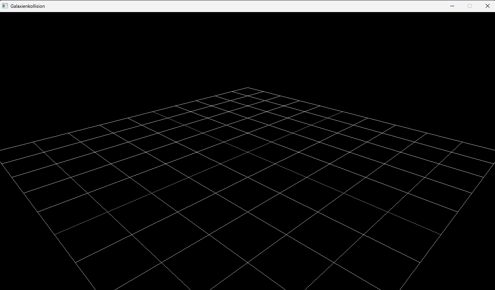
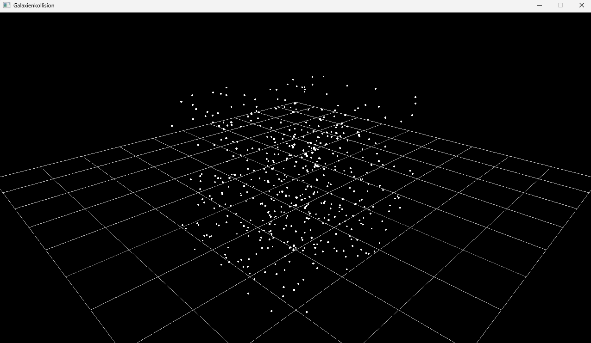

# Tests und Messwerte

Jeder Test folgt dem Schema **Was → Wie → Erwartet → Ergebnis**.

| Nr. | Datum | Was wird getestet | Wie | Erwartet | Ergebnis |
|---|---|---|---|---|---|
| T1 | 30.10.2026 | `Vec3::length()` (Betrag) | Manueller Test in `viewer.cpp`: `Vec3 v(3, 4, 12)`, Ausgabe von `v.length()` mit `std::cout` | 13 (√(9 + 16 + 144) = √169, siehe `theorie.md` 3.5) | 13 ✔ |
| T2 | 30.10.2026 | `Teilchenspeicher::hinzufuegen` und `anzahl()` | Manueller Test in `viewer.cpp`: benannter Speicher, ein Stern hinzugefügt, Ausgabe von `anzahl()` | 1 | 1 ✔ |
| T3 | 30.10.2026 | `zufaelligePunkte` und `positionen()`-Getter | Manueller Test in `viewer.cpp`: 500 Punkte, Radius 1, Seed 42; Ausgabe von `anzahl()` und der ersten Position; Programm zweimal gestartet | 500; x, y, z zwischen −1 und +1; beide Läufe identisch | 500; (−0.25092, 0.593086, 0.901429) in beiden Läufen ✔ |
| T4 | 31.10.2026 | Kamera und 3D-Modus | Sichtprüfung: Programm gestartet, `DrawGrid(10, 0.5f)` im 3D-Modus mit Kamera bei (3, 2, 3) | Gitter perspektivisch von schräg oben, Mitte im Bild | wie erwartet ✔ (Abb. 1) |
| T5 | 31.10.2026 | Umwandlung `zuVector3` und Zeichnen der Punktwolke | Sichtprüfung: 500 Punkte als `DrawSphere` mit Radius 0,01 | Punktwolke über und unter dem Gitter, Ausdehnung etwa ±1 (2 Gitterfelder je Richtung) | wie erwartet ✔, Form eines Würfels (siehe `theorie.md` 6.6) (Abb. 2) |
| T6 | 31.10.2026 | Kamerasteuerung | Sichtprüfung: erst `CAMERA_ORBITAL`, dann `CAMERA_FREE` mit `DisableCursor()`; Maus und W/A/S/D benutzt, mit Esc beendet | Orbital dreht automatisch; Free folgt der Maus ohne Ruckeln am Fensterrand | wie erwartet ✔; ohne `DisableCursor()` ruckelte die Kamera am Fensterrand |

### Abbildungen

**Abb. 1: Kamera und Gitter im 3D-Modus (T4)**

*Quelle: eigene Darstellung*

**Abb. 2: Zufällige Punktwolke aus 500 Punkten, Seed 42 (T5)**

*Quelle: eigene Darstellung*

**Hinweis:** T1 bis T3 sind provisorische Tests. Automatisierte Tests mit doctest in `tests/` folgen. Die Testausgabe wird danach aus `viewer.cpp` entfernt.

**Noch nicht getestet:** `operator+`, `operator-`, `operator*`, `operator/`