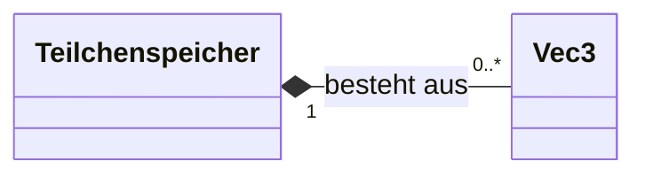
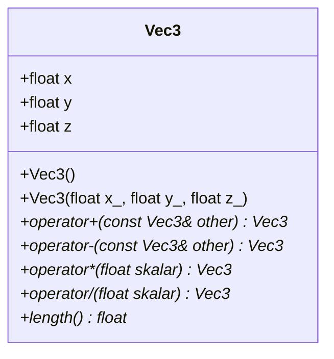
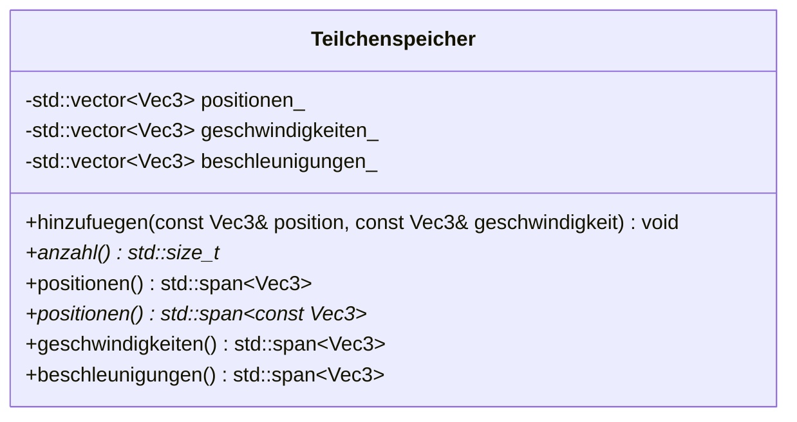

# UML-Klassendiagramme

Die Diagramme sind in **Mermaid** geschrieben. GitHub stellt sie direkt als Grafik dar. Für die schriftliche Dokumentation können sie z. B. mit dem Mermaid Live Editor (mermaid.live) als Bild exportiert werden.

**Legende:** `+` = public, `-` = private, `$` = static, `*` = Methode ist `const`

---

## Übersicht

Der Teilchenspeicher **besteht aus** vielen `Vec3` (Komposition): Die Vektoren gehören zum Speicher und existieren nicht ohne ihn.

---

## Vec3 (`src/core/vec3.hpp`) – umgesetzt

---

## Teilchenspeicher (`src/core/teilchenspeicher.hpp`) – teilweise umgesetzt

*Umgesetzt:* Attribute, `hinzufuegen`, `anzahl`. *Noch offen:* die `span`-Getter.

*Festgelegt:* deutsche Bezeichner; Vektoren `private`, damit die Invariante „alle drei gleich lang“ geschützt ist (siehe E9).

*Zugriff:* über `std::span` – Werte ändern ja, Größe ändern nein (siehe E10). Private Attribute enden auf `_` (z. B. `positionen_`), weil Attribut und Methode in C++ nicht denselben Namen haben dürfen. Die Getter heißen ohne Unterstrich (`positionen()`); ob es pro Vektor eine lesende `const`-Variante und eine ändernde Variante gibt, wird bei der Umsetzung festgelegt.